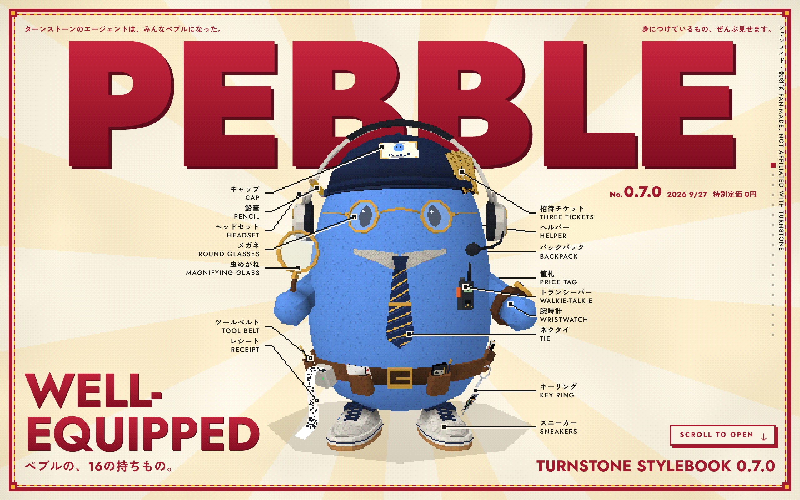

# PEBBLE: Well-Equipped

<p align="center">
  
</p>

> A fashion magazine with one model, and the model is a rock. Special price: ¥0.

One issue of a magazine that does not exist: a stylebook of the sixteen things a
[Turnstone](https://myturnstone.ai) Pebble carries. Each one stands for something Turnstone does.
Scroll, and they come off one at a time: the item floats out, enlarged, with its page of type; scroll on
and it goes back where it was.

Live at https://pebble-prime.vercel.app

Fan-made and unofficial: not affiliated with Turnstone. Product facts in the copy come from
myturnstone.ai and its changelog.

## What is on the page

- **Cover.** Cream paper with rays behind the Pebble, a chunky red-and-yellow border, a red masthead with the Pebble standing in front of it, sixteen
  small bilingual captions joined to their items by pixel hairlines, a heavy headline, small print down
  the edge.
- **Sixteen pages**, one for each item. The item leaves the Pebble, flies to the middle, turns slowly
  (or rocks, if it has lettering to read); its number, name, a few lines and a link sit beside it. A
  square mark on the Pebble shows where it was.
- **Back cover.** Turnstone's own line, a link out, and a way back to the front.
- **Furniture.** The masthead shrinks into the top left corner and is the way home; dots, centre right,
  one for each page. Nothing else: no menu, no settings, no sound, no progress bar.

| No. | Item | Stands for |
|---|---|---|
| 01 | Round glasses | One Brain, shared by everything you use |
| 02 | Cap | Agents appear as Pebbles, and Pebbles get outfits |
| 03 | Headset | Calls from Granola and Plaud arrive in the Brain |
| 04 | Three tickets | Invite a friend: three links every seven days |
| 05 | Price tag | The Free Plan: $0, 50 Schedule runs a month |
| 06 | Backpack | Knowledge stays on your Mac |
| 07 | Helper | Agents create helpers and delegate |
| 08 | Pencil | Tone: Agents sound like you |
| 09 | Magnifying glass | Ask anything: it searches, then answers |
| 10 | Receipt | See, edit or undo every Brain update |
| 11 | Tie | Each Agent has one job |
| 12 | Tool belt | Connected apps |
| 13 | Walkie-talkie | Other agents can reach yours over MCP |
| 14 | Wristwatch | Schedules |
| 15 | Key ring | Bring the AI you already pay for |
| 16 | Sneakers | Mac, iPhone, iPad and the browser |

## The look

**A magazine, printed by a games console.** The layout is a homage to the covers of the Japanese
magazine BRUTUS, and to its habit of taking one ordinary subject as the whole story and cataloguing it
piece by piece. Everything on the page except the type is drawn the way a mid-90s console would draw it,
in the same coarse pixels:

- the **Pebble**: few polygons, 32-pixel textures with no filtering, lighting worked out per vertex,
  vertices snapped to whole pixels, textures stretched flat across each triangle (so they swim a
  little), 15-bit colour with an ordered dither, a picture about 430 lines tall scaled up with hard edges;
- the **paper** (`src/paper.js`, a small shader on its own canvas under everything): big shaded
  triangles, dithered, with pale rays fanning out from behind whatever the page is about (集中線, the
  speed lines of manga and of every 90s games magazine); they follow an item as it flies out, and turn
  very slowly;
- the **border**, part of the paper: a solid red band, a dashed red-and-yellow line inside it and a
  block in each corner;
- the **hairlines**, dots and the mark that shows where an item was worn: one-pixel lines with
  stair-steps, drawn by the 3D stage in two layers, one behind the Pebble and one in front, and faded
  by dither rather than transparency;
- **buttons** with square corners and a hard shadow; square dots; a blinking arrow.

**The type is type.** Every word is real text in the page, set in
[Jost](https://indestructibletype.com/Jost.html) and
[Zen Kaku Gothic New](https://fonts.google.com/specimen/Zen+Kaku+Gothic+New) (both open source), and is
as sharp as the screen. The masthead and the cover headline are filled with the console's dithered red,
clipped to the letters: sharp outlines, pixel ink. The artwork, the model and the copy are original to
this project.

## The model

`public/models/pebble.glb` is built by a script, not by hand:

```sh
npm run model     # draws the textures, then runs Blender with no window
```

`scripts/textures.mjs` draws the pixel textures (with its own bitmap alphabet) into `blender/tex/`.
`blender/build_pebble.py` then makes every object out of lathes, lofts and boxes (`blender/kit.py`),
bakes ambient occlusion into the vertex colours by casting rays, and exports the GLB. Every accessory is
its own object with its own pivot, which is what lets the page take it off. Needs Blender 4 or later at
`/Applications/Blender.app`.

## How taking things off works

Each item has a first move that takes it straight clear of the Pebble (`exit` in `src/config.js`), then
a curved flight to its place on screen: towards the camera first, across second, so it never passes
through the Pebble. Coming back is the same in reverse. Three items cannot simply leave, so something
makes room for them:

- the **cap** is under the headset's band, so the headset widens and lifts, the cap comes out, and the
  headset sits back down;
- the **tool belt** goes round the Pebble, and the Pebble stands in its **sneakers**, so for those the
  Pebble hops, and what is leaving stays where it was until the Pebble is out of it.

How large an item floats is measured, not guessed: every vertex is projected at every angle the item
will be seen from, and the item is scaled until the outermost one touches its box.

## How the scroll works

Nothing really scrolls. A virtual scrollbar eases towards wherever the wheel or finger asked for, and
its offset, as a number from 0 to 1, drives everything: the camera, which item is out, which page of
type is up. Input is capped, so the camera cannot be flung past an item, and when the scroll enters an
item's stretch it glides to the middle of it and rests there. The page is as long as the window is tall,
so the pace is the same on a laptop and a tall monitor.

One function, `layoutFor()` in `src/webgl/path.js`, decides where everything goes for a given window:
side by side on a wide one, stacked on a tall one. The 3D and the type both read it.

## Code map

```
index.html            static shell; the first paint is paper, the frame and a counter
src/main.js           boot, the frame loop, going from page to page
src/config.js         all the copy, the sixteen items and how each comes off, scroll lengths
src/ui.js             cover, captions and hairlines, item pages, back cover, dots
src/styles.css        type and layers
src/paper.js          the dithered paper, its rays and its border; the dithered ink for the largest type
src/fonts.css         the slices of the Japanese face the copy uses (written by scripts/fonts.mjs)
src/scroll.js         the virtual scrollbar and its two plugins
src/anim.js           GSAP set-up
src/webgl/stage.js    renderer, shader, camera, taking items off and putting them back
src/webgl/path.js     layout for a window; scroll sections; camera pose for any scroll progress
src/dev.js, dev.html  a bench for the 3D alone (?section=3, ?p=0.42, ?orbit). Not built or deployed
src/qa3d.js           exact mesh-against-mesh tests for the bench
blender/              the model's source
scripts/              textures, fonts, icons, QA
```

## Develop

```sh
npm install
npm run dev          # http://localhost:5173
npm run build
npm run fonts        # after changing any Japanese copy
npm run meta         # favicon, app icons, og.jpg (needs the dev server on :5183)
```

## QA

Two kinds, both with Playwright.

```sh
npm run dev -- --port 5183 &
npm run qa:3d        # in the 3D bench: exact triangle tests
npm run build && npm run preview -- --port 5184 &
npm run qa           # on the built page, eleven window sizes, every page
npm run qa:sweep     # the whole scroll by wheel, photographed
```

`qa:3d` checks, for a wide and a tall window: that nothing worn cuts into anything it is not attached
to; that each item, at 73 points along its way out, touches nothing but its own seat, and lets go of
that early; that nothing leaves the frame during the move; and that the floating item, through its whole
turn, stays clear of the Pebble and of the type.

`qa` measures every page at every size: the ink of every line of type (inside the frame, not clipped by
its box, not on other type, not on the Pebble or the item), the Pebble and the item (inside the frame,
apart from each other), every control (on top where it is drawn), and the order of the layers.
The one overlap the page means is the masthead behind the Pebble on the cover; the report says how much.
